# E1-workroom 미션

## 📋 프로젝트 개요
Docker를 이용한 Nginx 웹서버 구축 및 배포  
바인드마운트(Bind Mount)를 활용한 데이터 영속성 실습

---

## 🚀 빠른 시작

```bash
# 1. 저장소 클론
git clone https://github.com/binary67890/E1-workroom.git

# 2. 폴더 이동
cd E1-workroom

# 3. Docker 이미지 빌드
docker build -t mywebsite .

# 4. 컨테이너 실행
docker run -p 8080:80 mywebsite

# 5. 브라우저에서 확인
http://localhost:8080
🛠️ 개발환경
🏢 사무실 PC
항목	내용
OS	Windows 11
WSL2	Ubuntu 22.04.5 LTS
Docker	29.9.2
Git	설정 완료
경로	/home/binary67/projects/mywebsite
🏠 집 PC
항목	내용
OS	Windows 11
WSL2	Ubuntu 22.04
Docker	설치 완료
Git	설정 완료
경로	/home/binary68/E1-workroom
🏫 교육장 PC (GNIA-C202-E01)
항목	내용
OS	WSL2 Ubuntu 26.04.1 LTS (Resolute)
Docker	29.9.3
Git	2.53.0
사용자	binary673054
경로	/home/binary673054/E1-workroom
📁 프로젝트 구조
code
📋 복사
E1-workroom/
├── Dockerfile              # Nginx 웹서버 설정
├── index.html              # 웹페이지 (한글 지원)
├── README.md               # 프로젝트 설명
└── bind-mount-test/        # 바인드마운트 실습 폴더
    └── index.html          # 바인드마운트 테스트 페이지
🐳 Docker 실습
기본 컨테이너 실행
bash
📋 복사
# 이미지 빌드
docker build -t mywebsite .

# 컨테이너 실행
docker run -p 8080:80 mywebsite

# 실행 중인 컨테이너 확인
docker ps

# 컨테이너 중지
docker stop [container_id]
🔗 바인드마운트(Bind Mount) 실습
개념
항목	설명
정의	호스트(WSL2)의 폴더를 컨테이너 내부 폴더에 직접 연결
특징	호스트 파일 수정 → 컨테이너에 즉시 반영
용도	개발 중 실시간 파일 수정, 로그 수집
차이	볼륨(Volume)은 Docker가 관리, 바인드마운트는 호스트 경로 직접 지정
동작 원리
code
📋 복사
[호스트 WSL2]                          [컨테이너 내부]
~/E1-workroom/bind-mount-test/  ←→  /usr/share/nginx/html/
        index.html  ←─────────────────────  index.html
        (파일 수정 시 컨테이너에 즉시 반영됨)
실습 명령어
bash
📋 복사
# 1. 실습 폴더 생성
mkdir -p ~/E1-workroom/bind-mount-test

# 2. 테스트 HTML 파일 생성
nano ~/E1-workroom/bind-mount-test/index.html

# 3. 바인드마운트로 컨테이너 실행
docker run -d \
  -p 8081:80 \
  -v ~/E1-workroom/bind-mount-test:/usr/share/nginx/html \
  --name bind-test \
  nginx

# 4. 브라우저에서 확인
http://localhost:8081

# 5. 컨테이너 중지 및 삭제
docker stop bind-test
docker rm bind-test
데이터 영속성 검증
bash
📋 복사
# 컨테이너 삭제 후에도 호스트 파일은 유지됨
docker rm -f bind-test

# 파일 확인 → 그대로 남아있음 ✅
ls ~/E1-workroom/bind-mount-test/
바인드마운트 vs 볼륨 비교
항목	바인드마운트	볼륨(Volume)
경로 지정	호스트 경로 직접 지정	Docker가 자동 관리
이식성	낮음 (경로 의존)	높음
용도	개발 환경, 실시간 수정	운영 환경, DB 데이터
명령어	-v 호스트경로:컨테이너경로	-v 볼륨이름:컨테이너경로
🔐 파일 권한
권한 설정 기준
대상	숫자	표기	의미
디렉토리	755	rwxr-xr-x	소유자: 읽기·쓰기·실행 / 그룹·기타: 읽기·실행
파일	644	rw-r--r--	소유자: 읽기·쓰기 / 그룹·기타: 읽기
권한 설정 명령어
bash
📋 복사
# 디렉토리 권한 설정
chmod 755 ~/E1-workroom

# 파일 권한 일괄 설정
find ~/E1-workroom -type f -exec chmod 644 {} \;

# 권한 확인
ls -la ~/E1-workroom/
📍 경로 개념
절대 경로 vs 상대 경로
구분	설명	예시
절대 경로	루트(/)에서 시작	/home/binary673054/E1-workroom/index.html
상대 경로	현재 위치에서 시작	./index.html, ../README.md
경로 확인 명령어
bash
📋 복사
pwd                        # 현재 위치 확인
realpath ./index.html      # 절대 경로로 변환
cat ./index.html           # 상대 경로로 파일 접근
📤 Git 명령어
bash
📋 복사
git status                 # 상태 확인
git add .                  # 파일 전체 추가
git add README.md          # 특정 파일 추가
git commit -m "메시지"      # 커밋
git push origin main       # 푸시
git pull origin main       # 풀
📝 터미널 로그 기록
bash
📋 복사
history                    # 모든 기록 보기
history 20                 # 최근 20개 보기
history | grep docker      # docker 관련 검색
history | grep git         # git 관련 검색
!!                         # 마지막 명령어 재실행
Ctrl + R                   # 역방향 검색

📚 학습 내용
## 🎯 실습 완료 및 향후 계획
### ✅ 완료한 항목
- [x] Windows WSL2 및 Ubuntu 환경 구축
- [x] Docker 설치 및 실행 확인
- [x] nginx 웹서버 구축 및 접속 확인
- [x] Docker 바인드 마운트 실습
- [x] Docker Volume 데이터 영속성 실습
- [x] Git 및 GitHub 연동
- [x] 사무실 PC GitHub 동기화 확인
- [x] 집 PC GitHub 동기화 확인
- [x] 교육장 PC GitHub 동기화 확인

### 📌 향후 학습 계획
- [ ] Docker Compose 학습
- [ ] Python을 활용한 웹 애플리케이션 개발

📞 참고사항
모든 명령어는 WSL2 Ubuntu 터미널에서 실행
Docker 이미지 이름: mywebsite
포트 매핑: 8080:80 (기본) / 8081:80 (바인드마운트 실습)
GitHub 저장소: E1-workroom
교육장 PC 경로: /home/binary673054/E1-workroom
작성일: 2025년 11월 07일
최종 수정: 2025년 11월 07일 (교육장 PC 환경 및 바인드마운트 실습 내용 추가)

code
📋 복사

---

### 저장 및 푸시

```bash
# nano 저장
Ctrl + O → Enter → Ctrl + X

# Git 커밋 및 푸시
cd ~/E1-workroom
git add README.md
git commit -m "docs: 교육장 PC 환경 및 바인드마운트 실습 내용 추가"
git push origin main

```
## 📸 미션 수행 증거 자료

### 1. 현재 작업 경로 확인 (`pwd`)

Ubuntu 터미널에서 `pwd` 명령어로
현재 작업 경로를 확인했습니다.

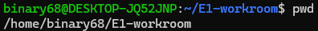

### 2. Linux 파일 목록 및 권한 확인

`ls -l` 명령어로 파일 목록과 권한을 확인했습니다.


### 3. Linux 파일 권한 변경

`chmod 600 permission-test.txt` 명령어로 파일 권한을 변경하고 결과를 확인했습니다.

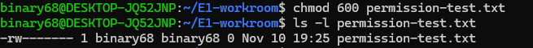

### 4. Docker 설치 버전 확인

`docker --version` 명령어로 설치된 Docker 버전을 확인했습니다.

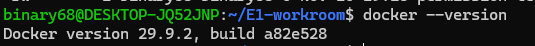

### 5. Docker 엔진 정보 확인

`docker info` 명령어로 Docker 엔진 정보를 확인했습니다.

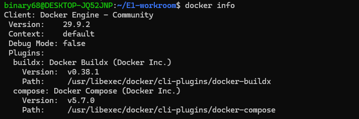

### 6. Docker 권한 오류 및 해결

일반 사용자로 Docker를 실행할 때 `permission denied` 오류가 발생했습니다.

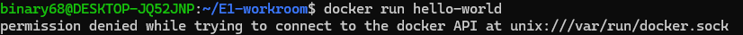

`groups` 명령어로 사용자 그룹을 확인한 뒤, `sudo usermod -aG docker $USER` 명령어로 Docker 그룹에 사용자를 추가했습니다. 이후 `newgrp docker`로 새 그룹 권한을 적용했습니다.

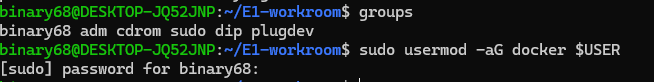

다시 `docker run hello-world`를 실행하여 정상 작동을 확인했습니다.

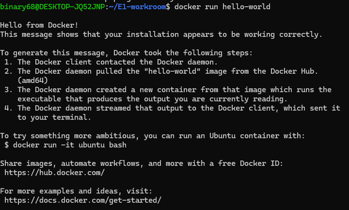

### 7. Docker 이미지 목록 확인

`docker images` 명령어로 로컬 이미지 목록을 확인했습니다.

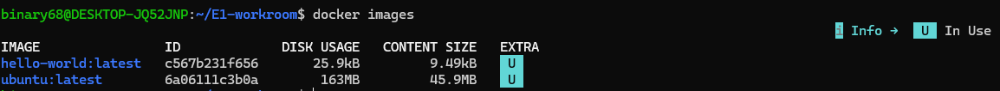

### 8. Docker 컨테이너 목록 확인

`docker ps -a` 명령어로 실행 중인 컨테이너와 종료된 컨테이너를 확인했습니다.

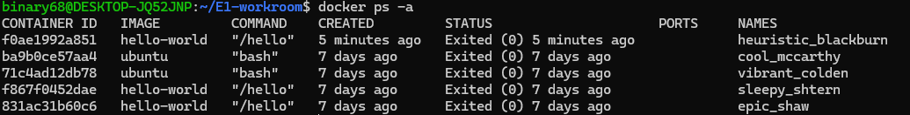

### 9. nginx 웹사이트 이미지 빌드

`docker build -t mywebsite:1.0 .` 명령어로 웹사이트 이미지를 빌드했습니다.

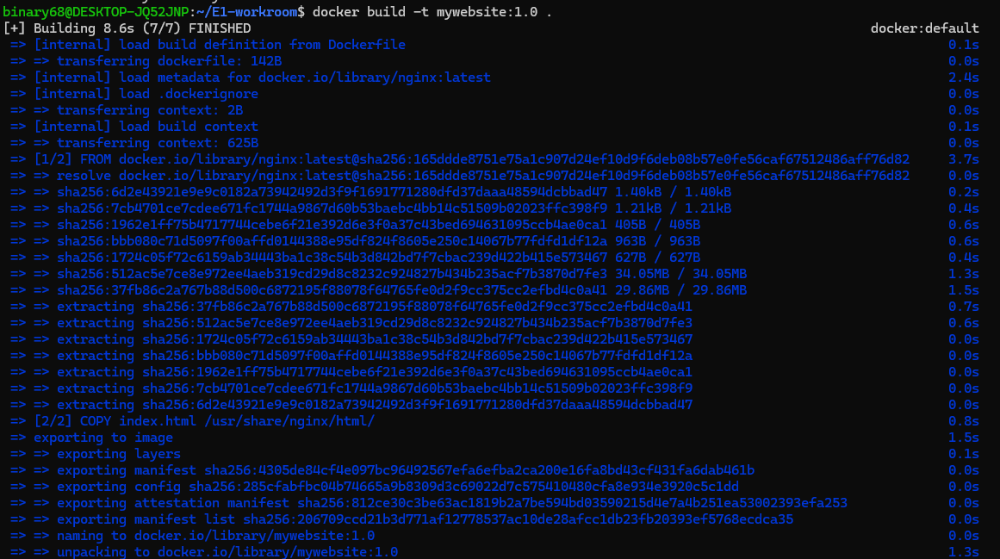

### 10. 웹사이트 실행 및 접속 확인

`docker run -d -p 8080:80 --name mywebsite-test mywebsite:1.0` 명령어로 웹서버를 실행하고, 브라우저에서 `http://localhost:8080` 접속을 확인했습니다.

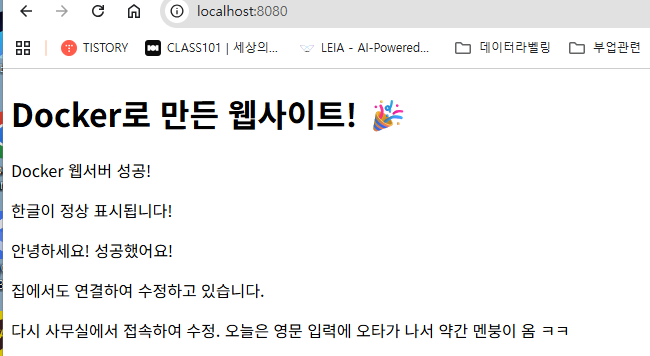

### 11. Docker 로그 확인

`docker logs mywebsite-test` 명령어로 웹서버 로그를 확인했습니다.

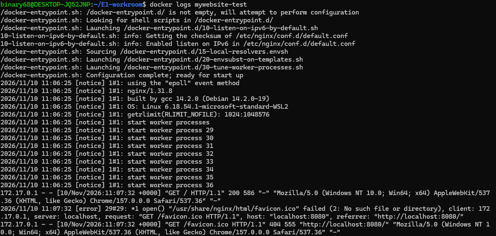

### 12. Docker 자원 사용량 확인

`docker stats mywebsite-test` 명령어로 CPU와 메모리 사용량을 확인했습니다.

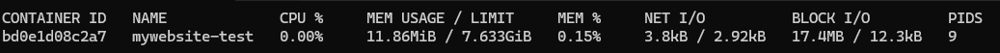

### 13. 바인드 마운트 실습

Ubuntu의 `bind-test` 폴더를 nginx 컨테이너에 연결했습니다.

변경 전 웹페이지:

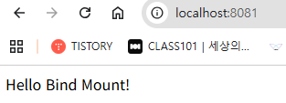

Ubuntu의 `bind-test/index.html` 내용을 수정한 후, 컨테이너를 다시 실행하지 않고 브라우저를 새로고침하여 변경된 내용을 확인했습니다.

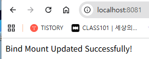

### 14. Docker 볼륨 데이터 보존 실습

`docker volume create mydata` 명령어로 볼륨을 만들고, `/data/test.txt`에 데이터를 저장했습니다.

**컨테이너 삭제 전 데이터 확인**

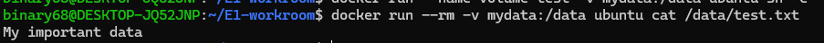

**기존 컨테이너 삭제**

`docker rm volume-test` 명령어로 컨테이너를 삭제했습니다.

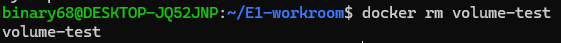

**컨테이너 삭제 후 데이터 확인**

새 임시 컨테이너에서 같은 볼륨을 연결하여 `My important data`가 남아 있음을 확인했습니다.

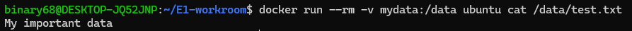

### 15. 실습 결과 정리

- Docker 이미지 빌드 및 nginx 웹서버 실행 확인
- Docker 접근 권한 오류 해결
- 바인드 마운트의 파일 변경 반영 확인
- Docker 볼륨의 컨테이너 삭제 후 데이터 유지 확인

## 📚 실습을 통해 이해한 핵심 개념

### 1. Docker 이미지와 컨테이너의 차이

Docker 이미지는 프로그램 실행에 필요한 파일과 설정을 담은 설계도와 같습니다. 컨테이너는 그 이미지를 바탕으로 실제 실행되는 환경입니다.

- `docker build`: Dockerfile을 이용해 이미지를 만듭니다.
- `docker run`: 이미지를 이용해 컨테이너를 생성하고 실행합니다.
- `docker ps -a`: 컨테이너 목록과 상태를 확인합니다.

### 2. Docker 포트 연결

`-p 8080:80`은 컴퓨터의 8080번 포트를 컨테이너의 80번 포트에 연결한다는 의미입니다.

따라서 브라우저에서 `http://localhost:8080`에 접속하면 컨테이너 안의 nginx 웹서버에 연결됩니다.

### 3. 바인드 마운트와 Docker 볼륨

바인드 마운트는 컴퓨터의 특정 폴더를 컨테이너에 연결하는 방식입니다. 이번 실습에서는 `bind-test/index.html`을 수정하자 웹페이지에도 변경 내용이 반영되었습니다.

Docker 볼륨은 Docker가 관리하는 데이터 저장 공간입니다. 이번 실습에서는 컨테이너를 삭제한 후에도 `mydata` 볼륨에 저장된 파일이 유지되는 것을 확인했습니다.

### 4. Git과 GitHub의 차이

Git은 파일의 변경 이력을 관리하는 도구이고, GitHub는 Git 저장소를 온라인에서 보관하고 공유하는 서비스입니다.

이번 미션에서는 사무실, 집, 교육장 PC에서 GitHub 저장소를 이용해 프로젝트를 동기화했습니다.

### 5. Linux 파일 권한

`ls -l`은 파일의 권한을 확인하는 명령어이고, `chmod`는 파일의 권한을 변경하는 명령어입니다.

`chmod 600 permission-test.txt`는 파일 소유자에게 읽기와 쓰기 권한을 주고, 그룹과 다른 사용자에게는 권한을 주지 않는 설정입니다.

## 📸 Git 설정 및 원격 저장소 확인

### 1. Git 설정 확인

`git config --list` 명령어를 실행하여 Git 설정 정보를 확인했습니다.

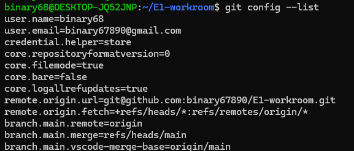

### 2. GitHub 원격 저장소 확인

`git remote -v` 명령어를 실행하여 원격 저장소의 가져오기(fetch) 및 올리기(push) 주소를 확인했습니다.

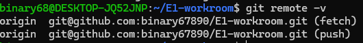

## 📸 바인드 마운트 데이터 영속성 검증

### 컨테이너 삭제 후 호스트 파일 보존 확인

바인드 마운트 실습에 사용한 `bind-test-container`를 중지하고 삭제했습니다.

```bash
docker stop bind-test-container
docker rm bind-test-container
```

이후 Ubuntu 호스트에서 다음 명령어를 실행했습니다.

```bash
ls -l bind-test/index.html
```

컨테이너를 삭제한 후에도 `bind-test/index.html` 파일이 남아 있음을 확인했습니다.

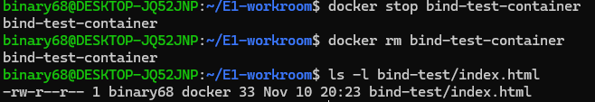

**실습 결과:** 바인드 마운트로 연결한 호스트의 원본 파일은 컨테이너를 삭제해도 유지됩니다.

## 📁 프로젝트 폴더 구성 및 설계 이유

이번 프로젝트는 웹사이트 실행에 필요한 파일과 실습 자료를 역할에 따라 구분하여 관리했습니다.

| 파일 또는 폴더 | 역할 | 분리한 이유 |
|---|---|---|
| `Dockerfile` | Docker 이미지 생성 설정 | 웹서버 실행 환경을 동일하게 재현하기 위해 |
| `index.html` | 기본 웹페이지 | 웹페이지 내용과 Docker 설정을 구분하기 위해 |
| `README.md` | 프로젝트 설명서 | 다른 사람이 실습 과정과 실행 방법을 이해하도록 하기 위해 |
| `bind-test/` | 바인드 마운트 실습 파일 | 기본 웹사이트와 별도로 파일 변경 실습을 진행하기 위해 |
| `screenshots/` | 실습 증거 사진 | 실행 결과를 한곳에 모아 확인하기 위해 |

### 설계 기준

프로젝트의 파일을 역할에 따라 구분하면 수정와 관리가 쉬워집니다.

예를 들어 웹페이지 내용을 변경할 때는 `index.html`을 수정하고, Docker 실행 환경을 변경할 때는 `Dockerfile`을 수정합니다.

또한 실습 증거 사진을 `screenshots/` 폴더에 모아 두면 README에서 상대경로로 연결할 수 있으며, GitHub에서도 실습 결과를 쉽게 확인할 수 있습니다.

이처럼 **실행 환경, 웹페이지, 실습 자료, 설명 문서를 분리하여 유지보수와 재현성을 높이는 것**을 프로젝트 구성의 기본 원칙으로 삼았습니다.

## 🌐 네트워크 네임스페이스와 포트 포워딩

### 1. 네트워크 네임스페이스란?

Linux의 네트워크 네임스페이스는 네트워크 인터페이스, IP 주소, 라우팅 정보 등을 서로 분리하여 관리하는 기능입니다.

Docker는 일반적으로 이 기능을 활용하여 컨테이너마다 독립적인 네트워크 환경을 제공합니다. 따라서 컨테이너 내부에서 실행되는 nginx 웹서버의 80번 포트가 호스트 컴퓨터의 80번 포트와 자동으로 연결되지는 않습니다.

### 2. 포트 포워딩이 필요한 이유

이번 실습에서는 다음 명령어로 nginx 컨테이너를 실행했습니다.

```bash
docker run -d -p 8080:80 --name mywebsite-test mywebsite:1.0
```

`-p 8080:80`은 호스트 컴퓨터의 8080번 포트를 컨테이너의 80번 포트에 연결하는 설정입니다.

브라우저에서 `http://localhost:8080`으로 접속하면 Docker의 포트 매핑을 통해 요청이 컨테이너의 nginx 웹서버로 전달됩니다.

### 3. 실습을 통해 이해한 점

컨테이너는 네트워크 환경이 분리되어 있으므로 외부에서 웹서비스에 접근하려면 적절한 네트워크 연결 설정이 필요합니다.

이번 실습에서는 포트 매핑을 이용하여 호스트의 브라우저에서 컨테이너 내부의 nginx 웹페이지에 접속할 수 있음을 확인했습니다.

## 🔧 Docker 포트 충돌 진단 및 해결 방법

### 1. 포트 충돌이란?

Docker 컨테이너를 실행할 때 호스트의 특정 포트를 다른 프로그램이나 컨테이너가 이미 사용하고 있다면 포트 충돌이 발생할 수 있습니다.

예를 들어 `-p 8080:80`으로 실행하려는데 호스트의 8080번 포트가 이미 사용 중이면 새 컨테이너가 해당 포트를 사용할 수 없습니다.

### 2. 포트 사용 상태 확인

먼저 실행 중인 Docker 컨테이너와 포트 연결 상태를 확인합니다.

```bash
docker ps
```

Linux에서 해당 포트를 사용하는 프로세스도 확인할 수 있습니다.

```bash
sudo ss -ltnp '( sport = :8080 )'
```

### 3. 포트 충돌 해결 방법

기존 Docker 컨테이너가 해당 포트를 사용하고 있고 중지해도 되는 경우, 컨테이너 이름을 확인한 뒤 중지합니다.

```bash
docker stop <컨테이너이름>
```

기존 서비스를 중지할 수 없다면 새 컨테이너에 다른 호스트 포트를 지정할 수 있습니다.

```bash
docker run -d -p 8082:80 --name mywebsite-alternative mywebsite:1.0
```

이 경우 브라우저에서 `http://localhost:8082`로 접속합니다.

### 4. 주의 사항

포트를 사용 중인 프로세스를 확인했다고 해서 무조건 종료해서는 안 됩니다. 먼저 해당 프로그램이 필요한 서비스인지 확인해야 합니다.

이번 항목은 실제 발생한 오류 사례가 아니라 향후 포트 충돌에 대비한 진단 및 해결 절차를 정리한 것입니다.

## 🛠️ 실제 오류 해결 사례: Docker 접근 권한 문제

### 1. 문제 발생

일반 사용자 계정에서 다음 명령어를 실행했습니다.

```bash
docker run hello-world
```

그러나 Docker 데몬에 접근할 권한이 없다는 `permission denied` 오류가 발생했습니다.


### 2. 원인 추정

Docker가 사용하는 `/var/run/docker.sock`에 현재 사용자 계정이 접근할 권한이 없을 가능성을 생각했습니다.

### 3. 원인 확인

다음 명령어로 현재 사용자가 속한 그룹을 확인했습니다.

```bash
groups
```

확인 결과, 사용자 `binary68`이 `docker` 그룹에 포함되어 있지 않았습니다.

### 4. 해결 조치

다음 명령어로 현재 사용자를 Docker 그룹에 추가했습니다.

```bash
sudo usermod -aG docker $USER
```

이후 새 그룹 권한을 적용했습니다.

```bash
newgrp docker
```

다시 `groups` 명령어로 Docker 그룹이 포함되었는지 확인했습니다.


### 5. 해결 결과 검증

다음 명령어를 다시 실행했습니다.

```bash
docker run hello-world
```

이번에는 `Hello from Docker!` 메시지가 나타나 정상 작동을 확인했습니다.


### 6. 배운 점

Docker 명령어에서 권한 오류가 발생하면 무조건 `sudo`를 붙이기보다, 먼저 사용자 그룹과 Docker 소켓 접근 권한을 확인하는 것이 중요하다는 점을 배웠습니다.

또한 Docker 그룹에 속한 사용자는 높은 수준의 시스템 권한을 가질 수 있으므로, 신뢰할 수 있는 사용자에게만 해당 권한을 부여해야 합니다.

이번 실습을 통해 오류 메시지 확인, 원인 추정, 명령어를 통한 검증, 해결 조치, 정상 작동 확인이라는 문제 해결 과정을 경험했습니다.